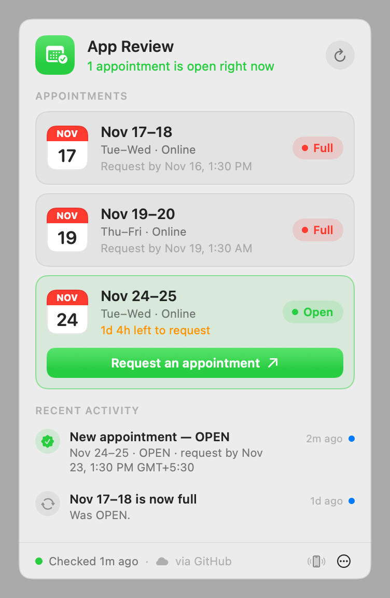

# App Review Watcher

Alerts you the moment Apple posts a new **App Review appointment** on
[Meet with Apple](https://developer.apple.com/events/view/upcoming-events/), or when a full one opens up again.

These appointments fill within hours and Apple doesn't announce them, so this checks the public
schedule every 10 minutes and tells you on your phone and in your Mac's menu bar.

<picture>
  <source media="(prefers-color-scheme: dark)" srcset="docs/panel-dark.png">
  
</picture>

It does not book anything for you. Requesting an appointment needs your Apple Account, so the alert
links straight to the page and you request it yourself.

## How it works

| Part | Where it runs | What it does |
|---|---|---|
| `watch.mjs` on a schedule | GitHub Actions, every 10 minutes | Opens Apple's public schedule in headless Chrome, reads each App Review appointment's status, and sends a phone alert when something changes. Runs whether or not your Mac is on. |
| `watch.mjs` on your Mac | Every 5 minutes while the Mac is awake | Copies the cloud's latest results for the menu bar app and shows a banner for new alerts. If the cloud hasn't checked in 25 minutes, the Mac checks Apple itself. |
| Menu bar app | Your Mac | Shows every listed appointment, its status and request deadline, and recent activity. |

An appointment counts as **open** when its page shows a Request or Register button and no
"Registration full" notice. Open results are confirmed with a second page load before an alert goes out.

The menu bar icon stays a quiet calendar while nothing is available. It turns green and says **Open**
when you can request an appointment, shows a red bell for unread alerts, and an orange warning if
checks have stopped getting through.

## Set up your own copy

You need a Mac with [Node.js](https://nodejs.org), Google Chrome, Xcode (or its command line tools)
and the [GitHub CLI](https://cli.github.com).

1. Fork this repository and clone your fork.
2. Install the Mac side. This builds the menu bar app, schedules the watcher and starts both at login:
   ```sh
   ./scripts/install-mac.sh
   ```
   It prints a random [ntfy](https://ntfy.sh) topic name at the end.
3. Install the ntfy app on your phone and subscribe to that topic.
4. Give the cloud watcher the same topic, and your time zone for the times shown in alerts:
   ```sh
   gh secret set NTFY_TOPIC --body "the-topic-from-step-2"
   gh variable set WATCH_TIMEZONE --body "Asia/Kolkata"
   ```
5. Enable Actions on your fork and run the **Watch App Review appointments** workflow once from the Actions tab.

Use **Send Test Alert to Phone** in the menu bar app's ⋯ menu to confirm phone alerts arrive.

### Optional: get told if the watcher itself stops

Create a free check at [healthchecks.io](https://healthchecks.io) with a 30-minute period and save its
ping URL as a secret. The watcher pings it after every successful check, so you hear about it if the
checks stop for any reason:

```sh
gh secret set HEALTHCHECK_URL --body "https://hc-ping.com/your-check-id"
```

## Good to know

- GitHub's scheduler is best-effort. Runs are sometimes 5–15 minutes late, which is why the Mac acts as a fallback.
- ntfy topics are readable by anyone who knows the name. The installer generates a long random one; keep it out of the repository.
- Results are stored as a single commit on the `state` branch, so the main branch history stays clean.
- To watch a different kind of activity, set the `WATCH_MATCH` environment variable to a pattern such as `group lab`.
- `./scripts/uninstall-mac.sh` removes the Mac side.

## Files

- `watch.mjs`: the watcher (used both in the cloud and on the Mac)
- `.github/workflows/watch.yml`: the cloud schedule
- `MenuBarApp/`: the SwiftUI menu bar app
- `scripts/`: Mac install and uninstall
